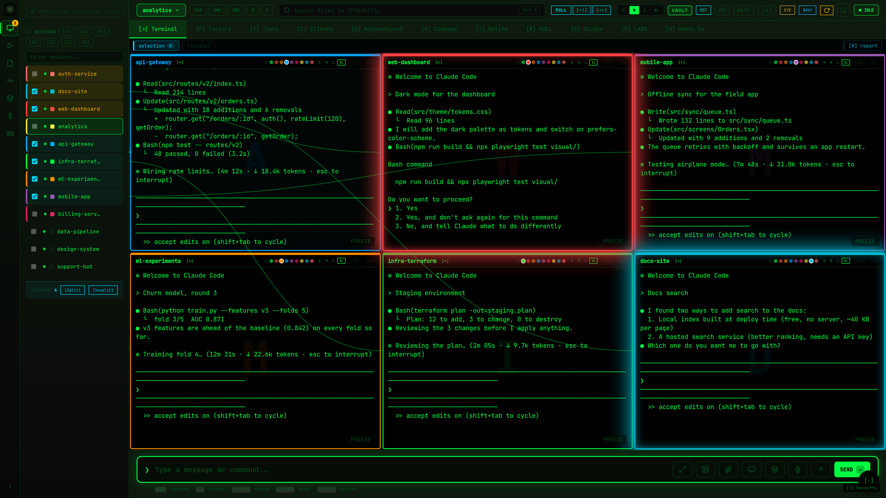
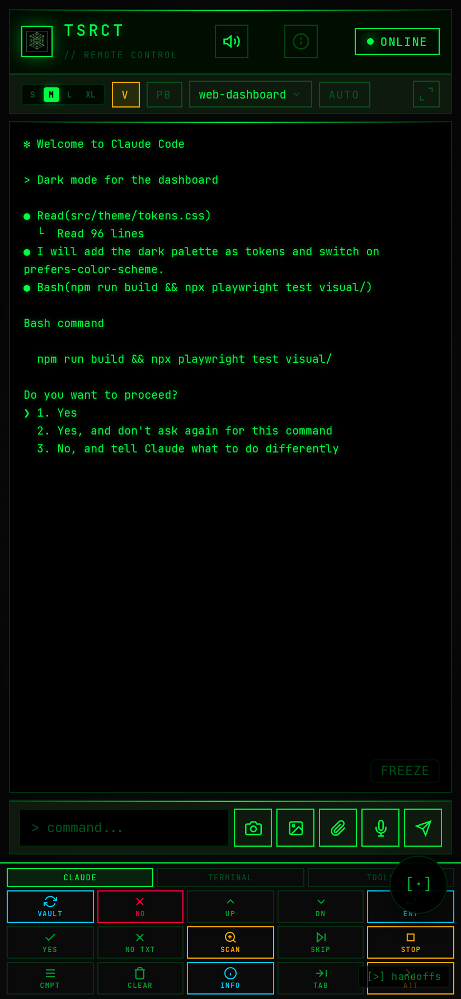

# TSRCT

**A control room for many Claude Code sessions at once** - from your desk, your phone, or anywhere
in the world your tailnet reaches.

TSRCT (Tesseract Remote Control Terminal) runs your Claude Code sessions in tmux and gives you one
screen to drive all of them: see every session live, answer their permission requests, split a dozen
of them on one screen, hand a heavy session off to a fresh one, and talk to it all through **Tesla**,
a voice assistant that can read the sessions, open new ones, and act on your PC.

This is not a chat window onto one cloud session. It is your whole machine - every terminal, every
project, the desktop itself - reachable from a phone, behind a private network and a hardware login.

It is one person's daily tool, built in the open: vanilla JavaScript, zero npm dependencies, no build
step, and 31 checks that run before every commit.



<p align="center"></p>

## The unusual parts

**Tesla: the model is the mouth, not the brain.** Speak, and what your sentence *means* is decided
in code first (`lib/understand.js`), then matched against a declared catalogue of 83 actions
(`lib/actions.js`). Only a catalogued action can run, each one declares how its result is verified,
and anything that changes something asks once. The language model phrases the answer; it never gets
to invent what happens. Six destructive buttons have no voice handle at all - those take a finger.

**Its brain is a hidden Claude session, read from disk, not scraped from the screen.** Each project
gets a background Haiku session (`lib/haikuBrain.js`) started with a known session id; the answer is
read from Claude Code's own transcript file, so a change in how the terminal looks cannot break it.
It may only read (`Read Grep Glob`), so it can never stall on a permission nobody sees. Measured
before building: a one-shot `claude -p` took 10-15 s, about 6 of them just starting the process; a
session that stays open pays that once.

**Approve permissions in bulk, by voice.** "Approve everything the api session is asking" answers exactly the
cards the phone would show, the same way a tap does (`lib/permissionDesk.js`). No keystroke is ever
typed into a pane to do it.

**Hands on your PC, with a dead-man switch.** Tesla opens apps and files, arranges windows across
monitors and runs named shortcuts, direct paths first and the mouse last. Before it clicks, it must
have looked at the screen in the last 60 seconds; it asks once; and the moment *you* move the mouse
it stops for three minutes. When no action fits, the job goes to a visible `hands` session whose
permissions you approve like any other, and every workaround is logged so it can become a real
button later.

**The Projector.** A session can drive its own headless browser for web work while you watch it live
in TSRCT, frame by frame over the tailnet. Your mouse stays yours.

**It calls you.** When a session truly needs you, the server rings your phone like a call: an urgent
ntfy alert plus a Web Push, repeated until you open the app, which acks and silences it
(`lib/ring.js`). ntfy can be self-hosted on the same tailnet, so the alert never touches a public
service.

**Sessions that hand themselves off.** Measured on 24,734 real turns: turns over 300k tokens of
context were 27% of turns and 51% of the bill. TSRCT reads each session's weight from a hook (zero
tokens), warns at 200k, and hands the work to a fresh session at a safe moment - never mid-turn
(`lib/sessionWeight.js`). A lead session in an orchestrated team can also compact and resume
*itself* through a local-only route.

**Restricted projects, fail closed.** Name the projects that must never reach an AI service or leave
the machine (a client under NDA, a Bedrock-only account). Every egress point refuses them: git and
Salesforce routes, every headless job, notifications, the voice. Tesla's screen-reading eyes close for
two minutes after any request that names one, and its background workers get a deny rule in their own
settings, not just a sentence in a prompt. `scripts/check-restricted.js` fails the build if any of
those points loses its guard.

**A morning routine.** At the hour you pick, it reads your day and opens the sessions it calls for,
with a brief waiting on screen. The scheduled jobs live in the server, so they run only while TSRCT
runs, and the Automations tab has one switch per background loop.

**And:** remote desktop over VNC with audio and a **VR mode**, multi-monitor window roles, a split
view that fits 20 sessions, a stall watchdog that logs every time the server's thread blocks
(`lib/stallWatch.js`), and a mobile PWA that installs on your home screen.

## Secure by layers: remote access through Tailscale

TSRCT can type into your terminals and click on your PC, so it is built like SSH, not like a web app.
Each layer below holds even if the one above it fails. The full model is in
**[docs/SECURITY.md](docs/SECURITY.md)**.

| Layer | What stops an attacker there |
|---|---|
| **No public port** | The server binds `127.0.0.1` only. Nothing on your LAN, let alone the internet, can reach it. |
| **Tailscale** | `tailscale serve` is the only way in: WireGuard-encrypted, HTTPS, and only devices signed into *your* tailnet can even open a connection. Funnel stays off, so there is no public URL to find. |
| **A login on every device** | Being on the tailnet is not enough. Every `/api/*` route sits behind one gate, and a remote request needs a session from Windows Hello / WebAuthn (passkey, bound to its origin) or the token plus a TOTP code. 5 failed logins lock that device out for 15 minutes. |
| **Default-deny "remote"** | The master token works only for a direct connection from this machine (the Claude Code hooks). Any proxy header at all - Tailscale's, any `x-forwarded-*` - marks a request remote, so a new kind of ingress can never be mistaken for local. |
| **No shell, ever** | Every command runs argv-based through one helper, so a session name or a path can never become shell code. |
| **Data boundary** | Restricted projects never reach a model or a third party, enforced at choke points and checked on every commit. |

## Requirements

- **Linux, or Windows with WSL2** (it was built on WSL2; the PC features need Windows + PowerShell)
- **Node.js 22+**, **tmux**, and the **Claude Code** CLI
- **Tailscale** for remote access (strongly recommended over any other way of exposing it)
- Optional, per feature: Ollama (local model), Piper or edge-tts (voice), ntfy (phone alerts),
  chrome-headless-shell + puppeteer-core (Projector)

## Install

**1. Have your own Claude Code read it first.** TSRCT has zero dependencies, so every line that
will run is right here in the repository. Clone it, run `claude` inside the folder, and ask:

```
Read this repository before I run anything. Tell me what scripts/setup.js installs,
what it changes on my machine, every address the server connects to, and whether
anything sends data off this computer.
```

**2. Run the guided setup.**

```bash
git clone https://github.com/leonlurk/TSRCT.git && cd TSRCT
npm run setup
```

It checks what you already have, and for anything missing shows the exact command and asks before
running it, or opens the download page and waits while you install it. It writes `.env` for you (a
fresh random password, your folders, your time zone), adds TSRCT's hooks to Claude Code next to your
own, and then asks yes or no about each optional part: remote access, phone alerts, Tesla's voice,
the local model, remote desktop, the morning routine. Every file it changes is backed up first, and
it is safe to run again. `npm run setup -- --dry-run` shows what it would do without changing anything.

**3. Start it.**

```bash
node server.js                # then open http://127.0.0.1:3847 and log in with the BRIDGE_TOKEN in .env
npm run doctor                # any time: one line per part, working or what to fix
npm run check                 # the full test suite, 31 checks, about a minute
```

Enroll Windows Hello (or add the 2-factor key the server prints on first boot to your
authenticator app) **before** you go remote. The setup offers to run `tailscale serve`; by hand:

```bash
tailscale serve --bg 3847     # https://<machine>.<tailnet>.ts.net, tailnet only
tailscale funnel status       # must show no funnel: TSRCT is never public
```

## How it is built

- `server.js` - boot and the auth gate; all 170 API routes live in `lib/routes/`, in 15 groups tried
  in order.
- `lib/` - the features: Tesla (`talk.js`, `haikuBrain.js`, `actions.js`, `understand.js`), the PC
  (`desk*.js`, `pcDirect.js`, `teslaHands.js`), the Projector, the scheduler and morning routine, the
  guard (`dispatcher/restrictedGuard.js`), all paths in one place (`paths.js`).
- `src/` - the PWA: plain IIFE modules that publish on `window`, no framework.
- `scripts/check-*.js` - the suite. `npm run check` runs all of them and fails at the end. Among them:
  a route inventory and auth-gate check; a check that sends 684 requests through the real route
  code and compares every status and reply with a recorded snapshot; a check that drives a whole
  Tesla turn through each brain; the restricted-projects guard check; and `check-public.js`, the
  release gate that keeps private names, paths and secrets out of this repository.

`CLAUDE.md` holds the working rules (it is what Claude Code reads in this repo) and
`DOCUMENTATION.md` the design notes and the measured gotchas, kept as they were written while building.

## License

MIT - see [LICENSE](LICENSE). By Leon ([leonlurk](https://github.com/leonlurk)).
